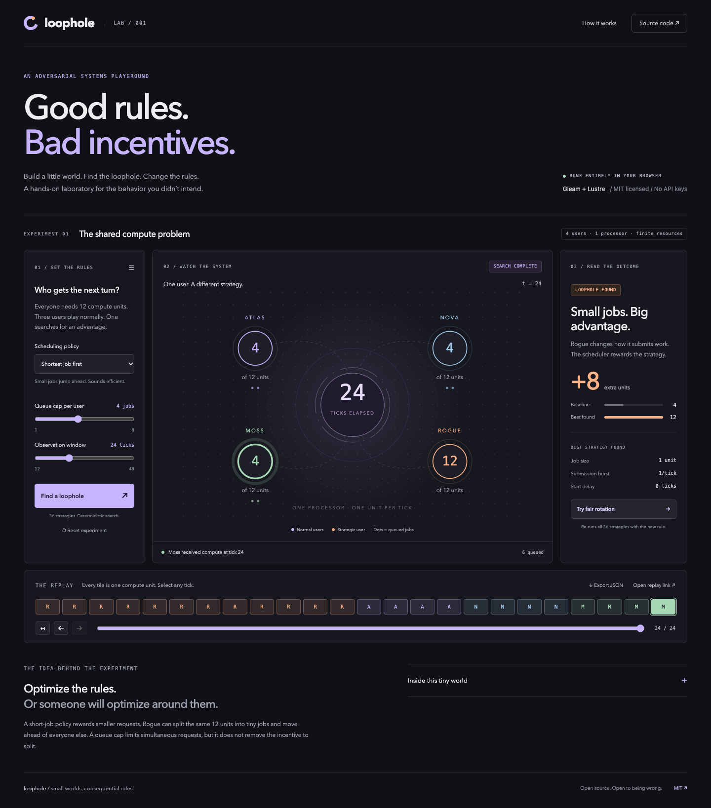

# Loophole

**Good rules. Bad incentives.**

A playable laboratory for unintended incentives. Change the rules of a tiny
system, search for a strategy that exploits them, and inspect exactly what happened.

**[Open the live playground](https://hamanakam1.github.io/loophole/)** ·
[How the model works](docs/MODEL.md) · [Contributing](CONTRIBUTING.md) · [MIT license](LICENSE)



## The first experiment

Four users share one processor. Everyone needs exactly 12 compute units.
Three submit normal jobs. The fourth, Rogue, searches for a better strategy.

1. Start with **Shortest job first**, a queue cap of **4**, and **24 ticks**.
2. Press **Find a loophole**. The app evaluates 36 submission strategies.
3. Rogue gets **12 units instead of 4** by splitting its work into one-unit jobs.
4. Select any tile in the replay to see the allocation at that tick.
5. Press **Try fair rotation**. All four users receive **6 units**. None of the
   36 tested strategies improves Rogue's allocation under this rule and window.

The workload did not change. The incentives did.

This is a small, executable example of a familiar scheduling problem, not a claim
to have discovered job-splitting attacks. The project brings rule editing,
bounded adversarial search, visual replay, and a reproducible record together in
an approachable browser experiment.

## What is in v0.1.0

- Two executable scheduling policies: shortest remaining job and fair user rotation.
- Editable per-user queue caps and observation windows.
- Exhaustive evaluation of a documented, finite set of 36 strategies.
- Baseline comparison using the same policy, cap, workload, and time window.
- Per-tick replay showing allocated work, the last served user, and pending jobs.
- Shareable replay links and JSON exports containing the full job trace.
- Responsive desktop and mobile interface, keyboard-operable controls, text
  alternatives for the visualization, and reduced-motion support.
- No account, API key, analytics, backend, or paid inference.

## Why Gleam + Lustre

[Gleam](https://gleam.run/) gives the simulation typed records, immutable state,
and explicit transitions. [Lustre](https://github.com/lustre-labs/lustre) uses that
same language for the browser UI. The simulation, search, state updates, SVG
visualization, and receipt serialization are written in Gleam.

A small JavaScript bridge synchronizes replay fragments and downloads JSON. Node
scripts build and serve the app. There is no JavaScript reimplementation of the
simulation and no LLM choosing or explaining the result.

## Run locally

Install **Gleam 1.19.2** and **Node.js 22 or newer**. This project uses Gleam's
JavaScript target; Erlang is not required for local development.

```sh
git clone https://github.com/hamanakam1/loophole.git
cd loophole
npm ci
gleam deps download
npm run build
npm run serve
```

Open **http://127.0.0.1:4179**. Rebuild after changing source files.
`PORT=4180 npm run serve` selects a different local port. If Gleam is not on your
PATH, `GLEAM_BIN=/path/to/gleam npm run build` works for the build command.

## Check the model

```sh
npm run check
```

This checks Gleam formatting, runs the Gleam tests, and builds the browser bundle.
The tests cover deterministic replay, actual exploit gain, fair rotation,
delayed submission, idle behavior, job-ID uniqueness, queue limits, and work
conservation. The invariant test explores every candidate strategy across both
policies and three queue caps, checking every frame through 48 ticks.

GitHub Actions runs these checks and deploys `dist/` to GitHub Pages on `main`.
Dependencies are locked; third-party Actions are pinned to commit hashes.

## Inspect an exported replay

Use **Export JSON** in the app. After building locally:

```sh
node scripts/verify-replay.mjs /path/to/loophole-replay-v1.json
```

The verifier recomputes the strategy, baseline, and every frame using the Gleam
engine and checks the exported record. A receipt is reproducible evidence of this
model's behavior, not a signature, attestation, or proof about a real service.

## Limits, deliberately visible

The search covers 36 fixed strategies. It does not search arbitrary programs or
adaptive strategies. Fair rotation assumes stable identities; Sybil attacks are
outside the model. There are no network delays, job-switching costs, variable
processor capacity, or stochastic workloads. At 48 ticks all users finish, so
the final allocation hides the earlier advantage. Shorter windows matter.

The current release has one scenario. New experiments should bring their own
explicit rules, useful counterexample, deterministic trace, and tests.

<details>
<summary>Fair rotation and mobile screenshots</summary>


</details>

## Contribute

Bug reports, better explanations, accessibility improvements, and new experiments
are welcome. See [CONTRIBUTING.md](CONTRIBUTING.md) for the development workflow.
The source and original visual assets are released under the [MIT license](LICENSE).
