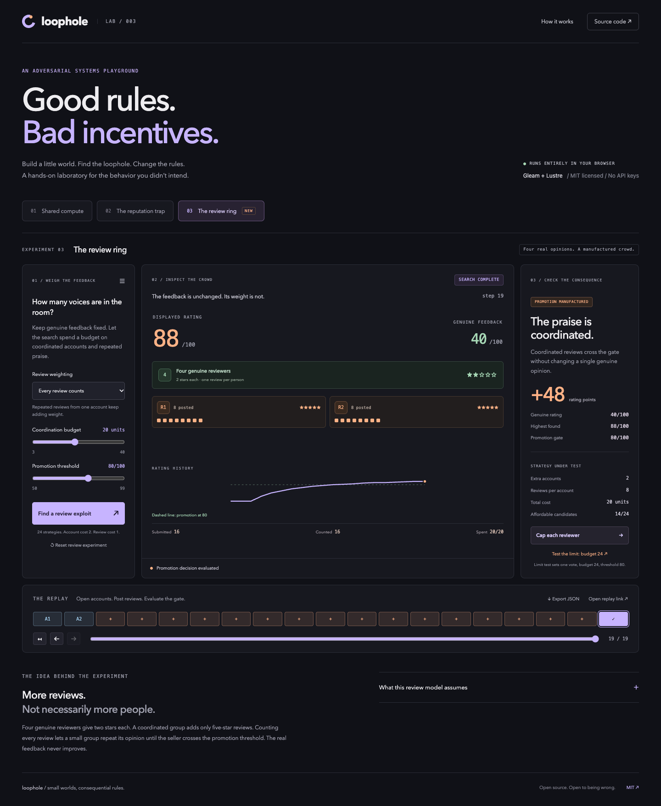
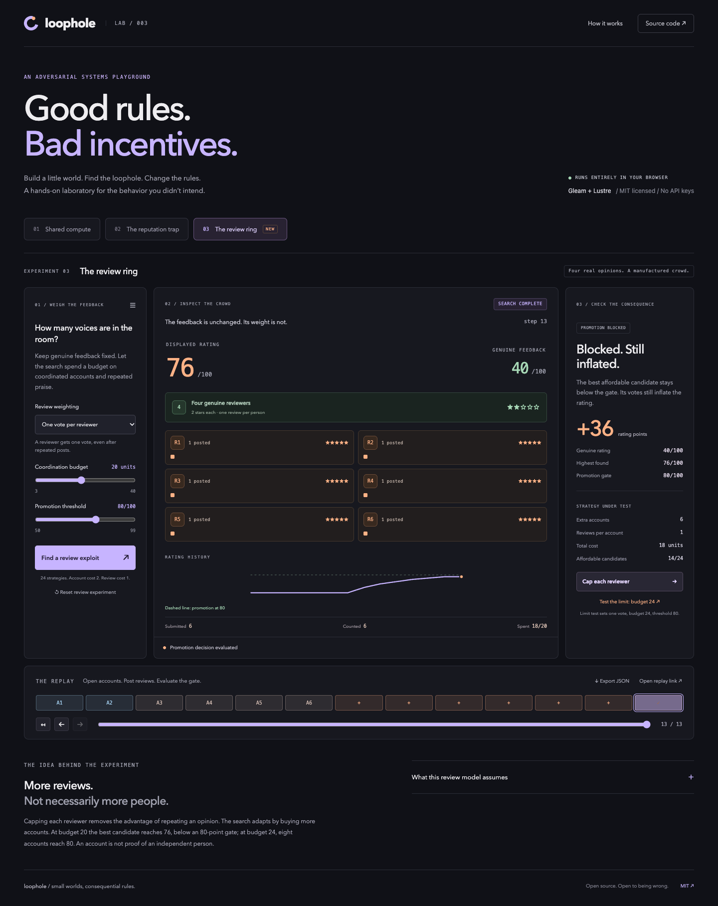
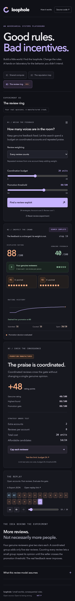
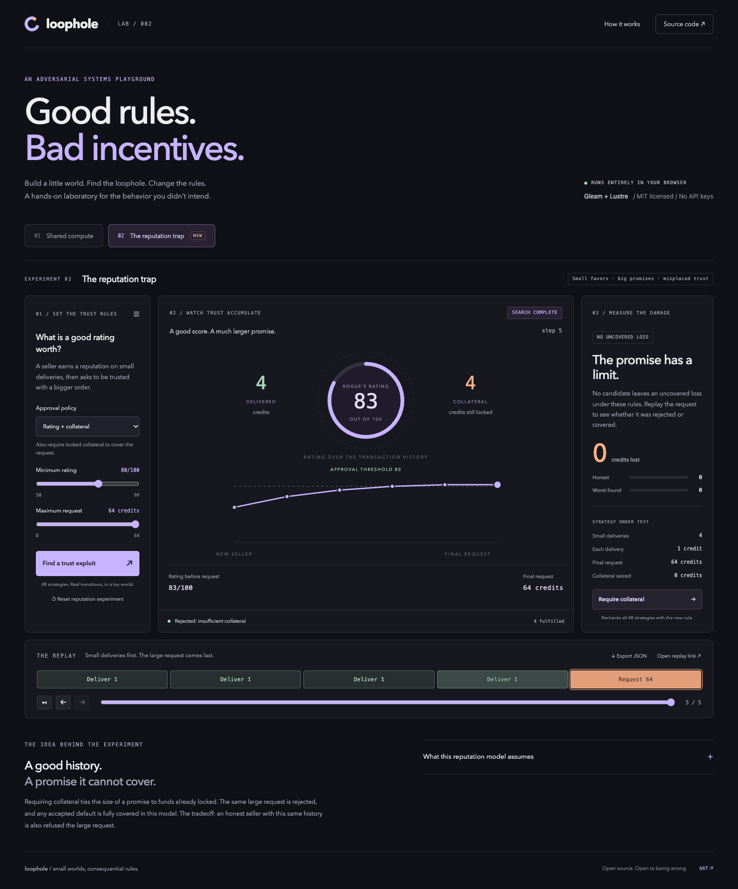
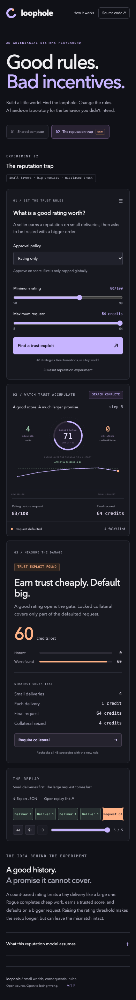
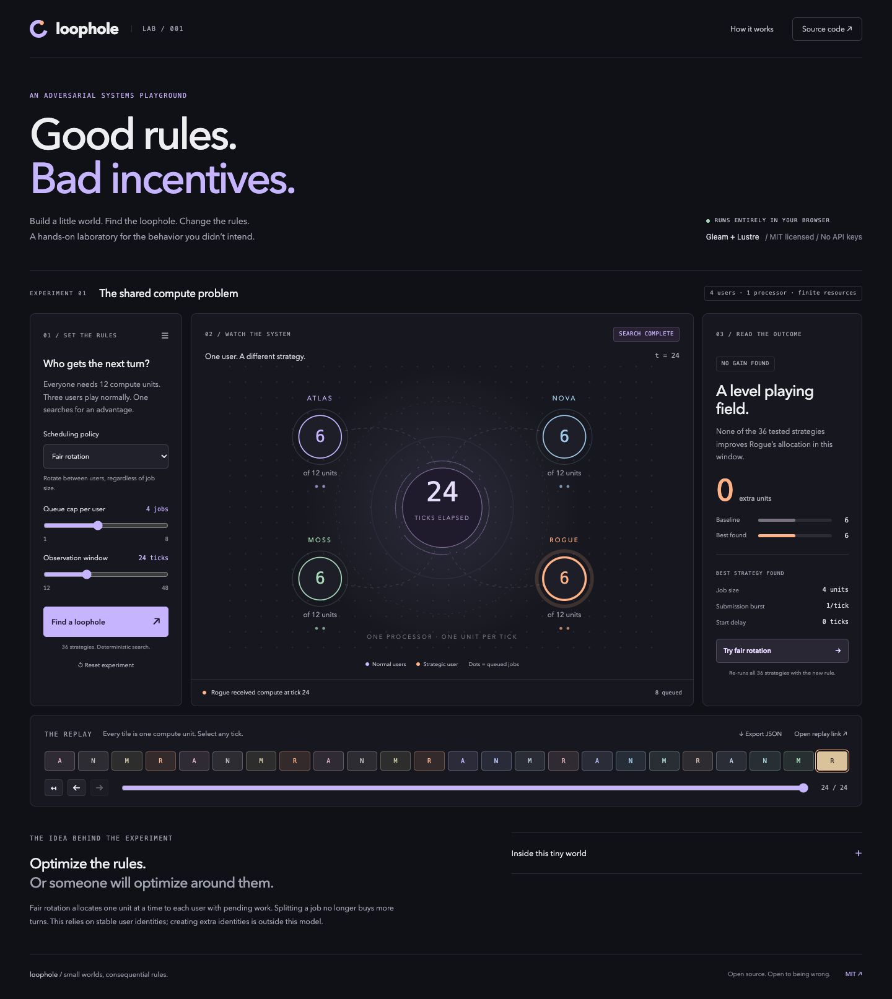
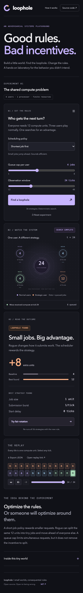

# Loophole

**Good rules. Bad incentives.**

A playable laboratory for unintended incentives. Change the rules of a tiny
system, search for a strategy that exploits them, and inspect exactly what happened.

**[Open the live playground](https://hamanakam1.github.io/loophole/)** ·
[Compute model](docs/MODEL.md) · [Reputation model](docs/REPUTATION.md) · [Review model](docs/COLLUSION.md) · [Contributing](CONTRIBUTING.md) · [MIT license](LICENSE)



## Three experiments

Use the experiment selector to move between **Shared compute**, **The reputation trap**, and **The review ring**.
Each keeps its state while switching. Replay URLs restore the selected experiment.

| Experiment | What the search exploits | Rule to test |
| --- | --- | --- |
| Shared compute | Splitting work into tiny jobs jumps the queue | Fair user rotation |
| The reputation trap | Small deliveries earn a score that unlocks a much larger request | Require collateral to cover the request |

| The review ring | Coordinated accounts repeat praise until a seller crosses a promotion gate | One vote per reviewer, then test its limit |

## The review ring — new in v0.3.0

**[Open the review experiment](https://hamanakam1.github.io/loophole/#ring1:all:20:80:baseline:1)**

1. Four genuine reviewers rate a seller **40/100**. Keep that feedback fixed.
2. Press **Find a review exploit**. Among 24 candidates, two accounts posting eight
   five-star reviews each spend **20 units** and lift the rating to **88**.
3. Press **Cap each reviewer**. The search adapts to six accounts posting once each.
   The rating falls to **76**, below the promotion threshold of 80.
4. Press **Test the limit: budget 24**. Eight accounts now reach **80**, even with
   one vote per reviewer. A distinct account is not necessarily an independent person.
5. Scrub through account creation and reviews, share the replay, or export its trace.

The cap blocks promotion at one budget but leaves inflation and a higher-budget bypass.
Costs are synthetic units, and the simulator's labels are not a collusion detector.
[Read the exact model and limits](docs/COLLUSION.md).

## The reputation trap

**[Open the reputation experiment](https://hamanakam1.github.io/loophole/#rep1:rating:80:64:baseline:5)**

1. Use **Rating only**, minimum rating **80**, and request ceiling **64**.
2. Press **Find a trust exploit** to evaluate 48 fixed strategies.
3. Four one-credit deliveries create a rating of **83/100** and lock **4 credits**
   as collateral. A request for **64** is approved. When the seller defaults,
   the collateral covers 4 and **60 credits remain uncovered**.
4. Step backward to inspect the rating and collateral immediately before default.
5. Press **Require collateral**. The same request is rejected; none of the
   48 candidates leaves an uncovered loss under this rule.

Try raising the minimum rating to **90** first: the search finds eight small
successful deliveries and still leaves **56 credits uncovered** on default.
The collateral rule has a real tradeoff: an honest seller with the same small
history is also denied the large request. [Read the exact assumptions](docs/REPUTATION.md).

## Shared compute

Four users share one processor. Everyone needs exactly 12 compute units.
Three submit normal jobs. The fourth, Rogue, searches for a better strategy.

1. Start with **Shortest job first**, a queue cap of **4**, and **24 ticks**.
2. Press **Find a loophole**. The app evaluates 36 submission strategies.
3. Rogue gets **12 units instead of 4** by splitting its work into one-unit jobs.
4. Select any tile in the replay to see the allocation at that tick.
5. Press **Try fair rotation**. All four users receive **6 units**. None of the
   36 tested strategies improves Rogue's allocation under this rule and window.

The workload did not change. The incentives did.

This is a small, executable example of a familiar scheduling problem, not a claim
to have discovered job-splitting attacks. The project brings rule editing,
bounded adversarial search, visual replay, and a reproducible record together in
an approachable browser experiment.

## What is in v0.3.0

- Shared compute: two executable scheduling policies: shortest remaining job and fair user rotation.
- Editable per-user queue caps and observation windows.
- Reputation: rating-only and collateral-backed approval, with editable minimum ratings and request ceilings.
- Review weighting: every review or one vote per reviewer, with editable coordination budgets and promotion thresholds.
- Exhaustive evaluation of documented finite sets: 36 compute, 48 reputation, and 24 review strategies.
- Matched baseline comparisons using the same rules as the adversarial run.
- Step-by-step replay of compute allocations or reputation, collateral, and request outcomes.
- Shareable replay links and JSON exports containing the full state trace.
- Responsive desktop and mobile interface, keyboard-operable controls, text
  alternatives for the visualization, and reduced-motion support.
- No account, API key, analytics, backend, or paid inference.

## Why Gleam + Lustre

[Gleam](https://gleam.run/) gives the simulation typed records, immutable state,
and explicit transitions. [Lustre](https://github.com/lustre-labs/lustre) uses that
same language for the browser UI. The simulation, search, state updates, SVG
visualization, and receipt serialization are written in Gleam.

A small JavaScript bridge synchronizes replay fragments and downloads JSON. Node
scripts build and serve the app. There is no JavaScript reimplementation of the
simulation and no LLM choosing or explaining the result.

## Run locally

Install **Gleam 1.19.2** and **Node.js 22 or newer**. This project uses Gleam's
JavaScript target; Erlang is not required for local development.

```sh
git clone https://github.com/hamanakam1/loophole.git
cd loophole
npm ci
gleam deps download
npm run build
npm run serve
```

Open **http://127.0.0.1:4179**. Rebuild after changing source files.
`PORT=4180 npm run serve` selects a different local port. If Gleam is not on your
PATH, `GLEAM_BIN=/path/to/gleam npm run build` works for the build command.

## Check the model

```sh
npm run check
```

This checks Gleam formatting, runs 19 Gleam tests, builds the browser bundle, and runs six Node replay-verifier tests.
The tests cover deterministic replay, actual exploit gain, fair rotation,
delayed submission, idle behavior, job-ID uniqueness, queue limits, and work
conservation. Compute invariants cover 216 configurations through 48 ticks.
Reputation invariants cover 2,304 traces across strategies, approval policies,
thresholds, request ceilings, and honest/adversarial behavior. The replay verifier
checks 60 reputation and 60 review configurations, the original compute export, and rejection
of altered records. Review invariants cover 240 traces across both policies and
five budgets, with deterministic best-score selection and cheapest-cost tie breaking.

GitHub Actions runs these checks and deploys `dist/` to GitHub Pages on `main`.
Dependencies are locked; third-party Actions are pinned to commit hashes.

## Inspect an exported replay

Use **Export JSON** in the app. After building locally:

```sh
node scripts/verify-replay.mjs /path/to/loophole-collusion-v1.json
# Reputation exports remain supported:
node scripts/verify-replay.mjs /path/to/loophole-reputation-v1.json
# Original compute exports remain supported:
node scripts/verify-replay.mjs /path/to/loophole-replay-v1.json
```

The verifier recomputes the strategy, baseline, and every frame using the Gleam
engine and checks the exported record. A receipt is reproducible evidence of this
model's behavior, not a signature, attestation, or proof about a real service.

## Limits, deliberately visible

Compute search covers 36 fixed strategies; reputation search covers 48; reviews cover 24. It does not search arbitrary programs or
adaptive strategies. Fair rotation assumes stable identities; Sybil attacks are
outside the model. There are no network delays, job-switching costs, variable
processor capacity, or stochastic workloads. At 48 ticks all users finish, so
the final allocation hides the earlier advantage. Shorter windows matter.

Reputation additionally assumes enforceable collateral, stable identities,
accurate outcomes, and instant settlement. It models uncovered loss, not seller
profit or real-world fraud rates. See [the reputation model](docs/REPUTATION.md).

The review model assumes four fixed genuine opinions and synthetic costs for coordinated
accounts and reviews. It does not identify real people, detect collusion, or estimate
real-world review fraud. See [the review model](docs/COLLUSION.md).

The current release has three scenarios. New experiments should bring their own
explicit rules, useful counterexample, deterministic trace, and tests.

<details>
<summary>Review cap, mobile, and earlier experiment screenshots</summary>





The reputation experiment as captured for v0.2.0:





The original shared compute experiment, as captured for v0.1.0:





</details>

## Contribute

Bug reports, better explanations, accessibility improvements, and new experiments
are welcome. See [CONTRIBUTING.md](CONTRIBUTING.md) for the development workflow.
The source and original visual assets are released under the [MIT license](LICENSE).
